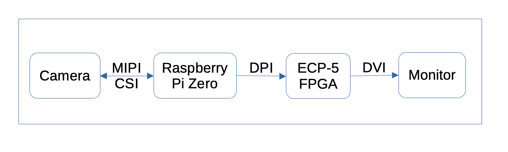
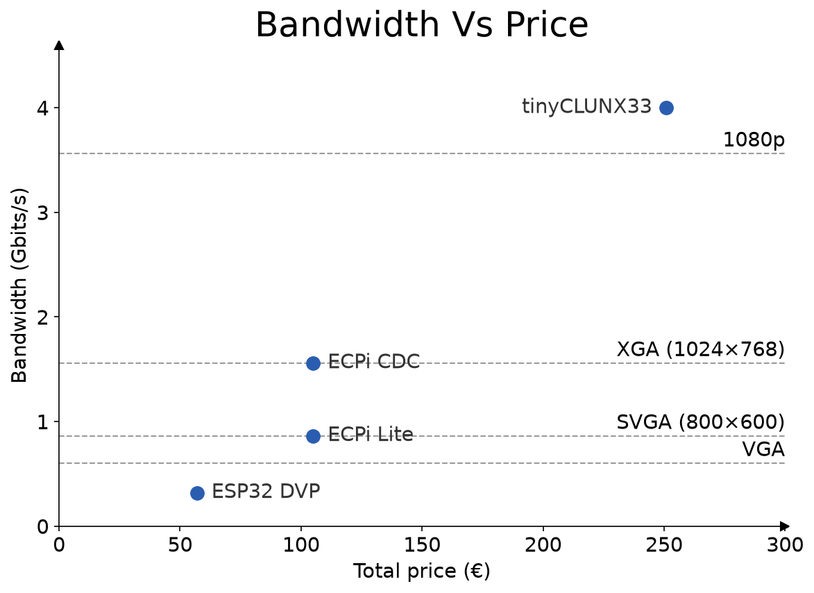
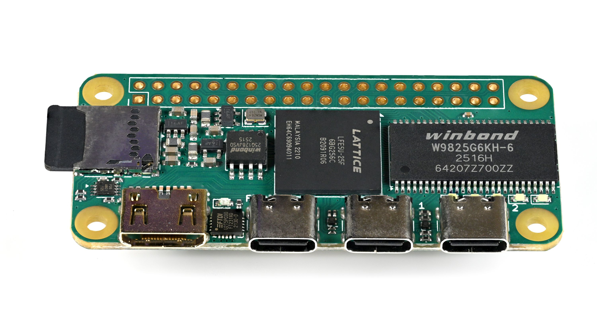

## [ECPi Camera](https://oshn.eu/ecpi-camera)

ECPi camera uses a ~$18 Raspberry Py Zero W to connect a Raspberry Pi
(RPi) compatible camera to an ECP5 FPGA, process the image, and
display it over DVI/HDMI or USB 3.  

The above diagram shows the data flow. 
Camera -> MIPI CSI -> RPI Zero W -> DPI -> FPGA -> DVI. 

An FPGA engineer could then insert their custom logic 
into the FPGA pipeline.  An embedded engineer could leverage the
capabilities of the RPi camera ecosystem.  An end user could plug the
DVI into a USB 3 dongle and receive the images on the desktop and save
or broadcast the images.

This system is much less expensive that
other FPGA image processing solutions, and it leverages the huge RPi
camera ecosystem.  This project is great for teaching and prototyping.
It will be used to develop better [edge detection
algorithms](https://oshn.eu/edge-detectors).

> [!CAUTION] This repository is still under development, about 30
> hours per week. Nov 8, 2026.  The firmware is written and mostly
> tested. Just waiting for the new camera to arrive.  The gateware is
> just being started on.

The Raspberry Pi Zero W converts the MIPI CSI signal into a Display
Parallel Interface (DPI).  DPI is a very simple, license free protocol
for transmitting images using parallel single ended wires. 

## COMPETITIVE MARKET ANALYSIS

While MIPI CSI is popular for image processing, it requires more
expensive FPGA boards.  The wires run at much higher frequencies, so
the boards are more difficult to design, and they are much much harder
to debug.  Recreating the full RPi ISP on an such an FPGA would
probably require more LUTs than are available.  And even if you did
buy a FPGA with a MIPI CSI hard core D-Phy, it would be good to have a
microcontroller to run the open source software to set all of the
registers in the image sensor.

In the Open Source world, the Lattice Crosslink NX17/40 with hard core
MIPI D-PHy are now once again available.  They are supported by YOSYS
and Nextpnr and the open source [Circuit Valley MIPI CSI
IP](https://github.com/circuitvalley/CHC5_Open_Camera). RPi ISP.  To
beneift from the D-phy and RPi, they would require an RPi 4 with MIPI
CSI, which is also more expensive than the RPi Zero W. 

The vertical axis is the bandwidth in gigabits per second.  The
horizontal bandwidth lines are some of the interesting display
modes. Their bandwidth is calculated as pixel clock × 24 bits. It is
the pipe bandwidth, not the image bandwidth: the active image is
smaller. The ESP32 solution processes 8 bits per clock.  ECPi
processes 24 bits per clock.  The tinyCLUNX33 uses
8b/10b encoding, so the bandwidth is 4/5 of the 5 Gbit/s USB pipe.
Here are the details of the competitive analysis.

| Setup | Parts | Price | Link | Bandwidth |
|---|---|---|---|---|
| ESP32-S3 | €43 [ESP32-S3](https://www.espressif.com/en/products/socs/esp32-s3/) + €14 [DVP Camera](https://www.waveshare.com/ov5640-camera-board-b.htm) | €57 | 40 MHz × 8 bits | 0.32 Gb/s |
| ECPi Lite | €71 [IcePi Zero](https://www.crowdsupply.com/icy-electronics/icepi-zero) + €16 [Raspberry Pi Zero W](https://www.raspberrypi.com/products/raspberry-pi-zero-w/) + €18 [Raspberry Pi Camera Module 2](https://www.raspberrypi.com/products/camera-module-v2/) | €105 | 36 MHz × 24 bits (800×600@56, 216 MHz / 6, shared clock) | 0.864 Gb/s |
| ECPi CDC | Same parts as ECPi Lite | €105 | 65 MHz × 24 bits (XGA) | 1.56 Gb/s |
| tinyCLUNX33 | €228 [tinyCLUNX33 Developer Kit - MIPI to USB]() + €23 [IMX219 Raspberry Pi Camera v2]() | €251 | USB 3: 5 Gb/s × 8/10 encoding | 4.00 Gb/s |

The horizontal lines represent the following standard display modes.

| Name | Resolution | Refresh | Pixel Clock | Bandwidth |
|---|---|---|---|---|
| VGA | 640×480 | 60 Hz | 25.175 MHz | 0.604 Gb/s |
| SVGA | 800×600 | 56 Hz | 36.000 MHz | 0.864 Gb/s |
| XGA | 1024×768 | 60 Hz | 65.000 MHz | 1.560 Gb/s |
| 1080p | 1920×1080 | 60 Hz | 148.5 MHz | 3.564 Gb/s |

## PARTS LIST

You will need the following parts. 

1. [IcePi Zero](https://github.com/cheyao/icepi-zero) from [Crowd Supply](https://www.crowdsupply.com/icy-electronics/icepi-zero) or 
   [Electrow](https://www.elecrow.com/icepi-zero.html?srsltid=AYCX9vJ-jhJyXHviFLSHDYzue3uK2wGutc1AkKseEEg6u17zY8MxGEy3).  IcePi Zero uses the 
[Lattice ECP5 FPGA](https://www.latticesemi.com/view_document?document_id=50461). 
2.  [Raspeberry Pi Zero W](https://www.raspberrypi.com/products/raspberry-pi-zero-w/). 
3. A micro SD card. Minimum 32 GByes, maximum 256 GBytes.
4. A micro SD card reader/writer. 
5. A raspberry Pi compatible Camera.  There are too many to list. 
6. A [raspberry Pi Zero camera cable](https://kamami.pl/en/ffc-fpc-cables/1178699-camera-cable-for-raspberry-pi-zero-38-cm-cb008-5906623404551.html) 15 pin to 22 pin.  Careful! It is not the standard RPi camera cable.
7. Male and Female Headers.
8. A power supply such as a cell phone charger.  USB Power is not
   enough for guarentee reliabile operations.
9. A USB-A to Micro-USB for connecting to power.
10. Mini-HDMI (GDPI mini) to standard HDMI cable or adapter for 
   RPI or FPGA video output.
11.  USB-A to USB-C, or USB-C to USB-C for programming the FPGA. 

## OPTIONAL
1. [Hammer Headers](https://shop.pimoroni.com/en-eu/products/gpio-hammer-header?variant=35643318026) if you do not wish to solder. 
1. USB (Male) to USB-A (Female) OTG cable to connect a keyboard, mouse
   or joystick to the RPI zero or IcePi Zero.
3. A Mini HDMI to USB3 dongle if you want USB3 video output.
4. USB-C to Micro-USB if you want additional serial communication 
   between the tso chips.
5. DVI Switchbox if you want to switch the monitor between your
   desktop, the FPGA and the RPI Zeros output.

## Assembly

Because the RPI Zero runs hot, it is recommended to have it on top.
If you are soldering, either device can have male or female
headers. If you are [hammering
headers](https://shop.pimoroni.com/products/gpio-hammer-header?variant=35643318026). or
[press fitting](https:/oshn.eu/ecpi-assembly) them, it is recommended
to have the trickier male headers be on the less expensive RPI Zero
facing down.  That way if you damage the part, it is a less expensive
loss.  Here is a blog posing about [hammer
headers](https://learn.pimoroni.com/article/fitting-hammer-headers),
scroll all the way down for how to do the female hat's header.  If you
are concerned about using hammer headers, here is an article
[reviewing the
product](https://hackaday.com/2017/01/16/review-hammer-installed-solderless-raspberry-pi-pin-headers/).
Basically the article and the comments say that hammer headers work
fine, and have some plusses and minuses.

My preference is to use the Hammer Headers, but do not hammer them,
use a vice to press fit them.  Press fitting is better for higher
volume production.

## Booting the Raspberry Pi Zero W

[RTFM](https://www.raspberrypi.com/documentation/computers/getting-started.html)

RPi Zero runs a whole Linux operating system.  For security, the
recommended practive is to install ssh keys, and disable password
login. If you have no experience with linux system administraitons, I
have found Claude.ai to be quite good at this stuff.

Install the Raspberry Pi **Lite** OS on SD card using the SD Card
Reader and the [Raspberry Pi
Installer](https://www.raspberrypi.com/documentation/computers/getting-started.html#install)
Configure the Wifi to connect to the device and allow software to be
downloaded.  This is the easy path, it is supported by the installer.
It is much easier to use wifi then the USB connection.  You just need
your wifi SSID and password.  Experienced FPGA developers will expect
to talk to the board over USB.  There are three problems with the USB
access.  If you are using USB, the expectation is that it provides
enough power, it does not.  A separate power supply, such as a cell
phone charger, is needed.  The second problem is that when you need to
download software to the device, configuring ethernet over USB is
tricky. And finally configuring tty over USB is also tricky.

## FirmWare and GateWare
Here is the [Raspberry Pi firmware](./firmware) and the [IcePi Zero
FPGA gateware](./gateware)

## DVI and USB Output 
For development it is fine to use the ECP5 DVI output.  Good to have a
DVI switchbox.  To show it off over Zoom, or capture images or video,
it is nice to have a DVI to USB dongle.  Make sure to buy a USB 3
dongle, not a USB 2 dongle.

## Questions???
Please [send me an email](mailto:lozinski@PythonLinks.info), or post an issue. 

