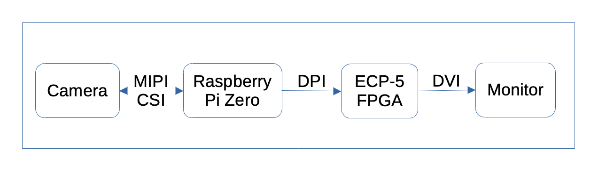
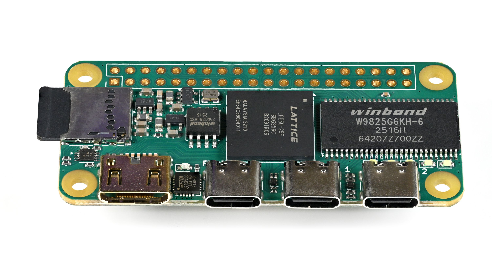

## ECPi Camera

ECPi camera uses a $12 Raspberry Py Zero W to connect any Raspberry Pi
compatible camera to an ECP5 FPGA, process the image, and display it
over DVI/HDMI or USB 3. 

> [!CAUTION]
> This repository is still under development, about 30 hours
> per week. Oct 26, 2026.

The Raspberry Pi Zero W converts the MIPI CSI signal into a Display
Parallel Interface (DPI).  DPI is a very simple, license free protocol
for transmitting images using parallel single ended wires.  While MIPI
CSI is popular, it has two problems.  The full MIPI CSI stack is not
supported by the open source YOSYS tools, and the Yosys compatible
Lattice NX17/40 chips have a two year order backlog.

## COMPETITIVE ANALYSIS

There are closed source FPGAs with MIPI CSI support, but they are all
more expensive.  And even if you did buy a MIPI CSI comptible FPGA,
it would be good to have a microcontroller to run the software to set all
of the registers in the image sensor. Best to start with the
inexpensive [ECPi Camera RGB888 application](https://oshn.eu/rgb888).

There is the similar Digital Video Port (DVP) protocol but there are no longer
commercially available image sensors with a 24 bit wide DVP data path. Only
lower resolution DVP images are possible. 

## PARTS LIST

You will need the following parts. 

1. [IcePi Zero](https://github.com/cheyao/icepi-zero) from [Crowd Supply](https://www.crowdsupply.com/icy-electronics/icepi-zero) or 
   [Electrow](https://www.elecrow.com/icepi-zero.html?srsltid=AYCX9vJ-jhJyXHviFLSHDYzue3uK2wGutc1AkKseEEg6u17zY8MxGEy3).  It uses the [Lattice ECP5 FPGA]
(https://www.latticesemi.com/view_document?document_id=50461). 
2.  [Raspeberry Pi Zero W](https://www.raspberrypi.com/products/raspberry-pi-zero/)  or any member of [that family](https://oshn.eu/raspberry-pi-chips)
3. A raspberry Pi compatible Camera.  There are too may to list. 
4. A [raspberry Pi Zero camera cable](https://kamami.pl/en/ffc-fpc-cables/1178699-camera-cable-for-raspberry-pi-zero-38-cm-cb008-5906623404551.html) 15 pin to 22 pin.  Careful! It is not the standard RPi camera cable. 
4. Male and Female Headers.
5. A power supply.  USB Power is not enough for reliability. 
6. USB-A to Micro-USB for connecting to power, or to a USB computer

## OPTIONAL
1. [Hammer Headers](https://shop.pimoroni.com/en-eu/products/gpio-hammer-header?variant=35643318026) if you do not wish to solder. 
1. USB (Male) to USB-A (Female) OTG cable to connect a keyboard to the
   RPI zero. 
2. USB (Male) to USB-A (Female) OTG cable to connect a mouse or joystick 
   to the RPI zero. Useful to control digital pan, tilt and zoom. 
3. Mini-HDMI (GDPI mini) to standard HDMI cable or adapter for 
   RPI or FPGA video output.
4. A Mini HDMI to USB3 dongle if you want to USB3 video output.
5. USB-C to Micro-USB if you want additional serial communication 
   between the tso chips.
6. DVI Switchbox if you want to switch between your desktop, the FPGA
   and the RPI Zeros output.

## Assembly

Because the RPI Zero runs hot, it is recommended to have it on top.
If you are soldering, either device can have male or female
headers. If you are [hammering headers]
(https://shop.pimoroni.com/products/gpio-hammer-header?variant=35643318026). or [press fitting](https:/oshn.eu/ecpi-assembly) them,  it is
recommended to have trickier male headers be on the less expensive RPI
Zero facing down. 
Here is a blog posing about [hammer headers]
(https://learn.pimoroni.com/article/fitting-hammer-headers), scroll
all the way down for how to do the female hat's header.  If you are
concerned about using hammer headers, here is an article [reviewing
the product]
(https://hackaday.com/2017/01/16/review-hammer-installed-solderless-raspberry-pi-pin-headers/).
Basically the article and the comments say that hammer headers work
fine, and have some plusses and minuses.

My preference is to use the Hammer Header, but do not hammer them, use a vice to press fit them. 

## FirmWare and GateWare
Here is the [Raspberry Pi firmware](./firmware) and the [IcePi Zero FPGA gateware](./gateware)

## USB Output 
For development it is fine to use the ECP5 DVI output.  Good to have a
DVI switchbox.  To show it off over Zoom, or capture images or video,
it is nice to have a DVI to USB dongle.  Make sure to buy the USB 3
dongle, not a USB 2 dongle.

## Questions???
Please [send me an email](mailto:lozinski@PythonLinks.info)

